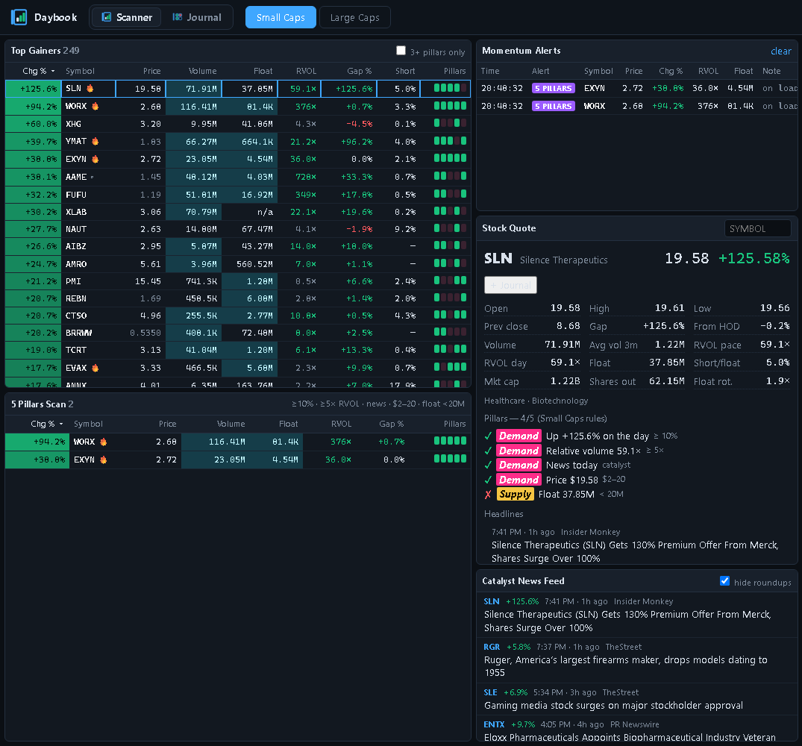
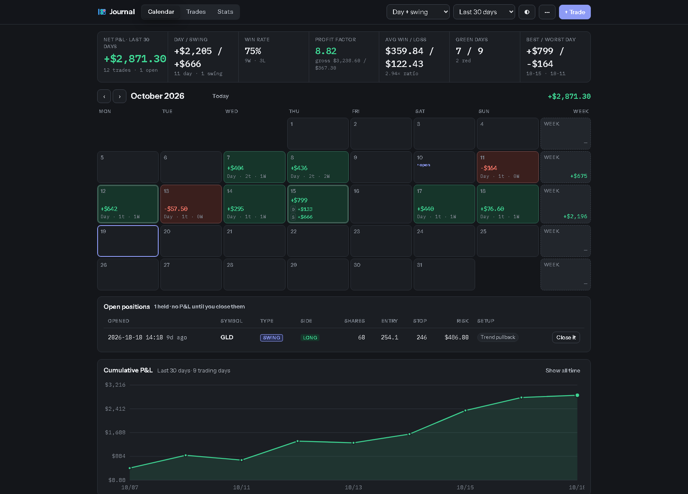
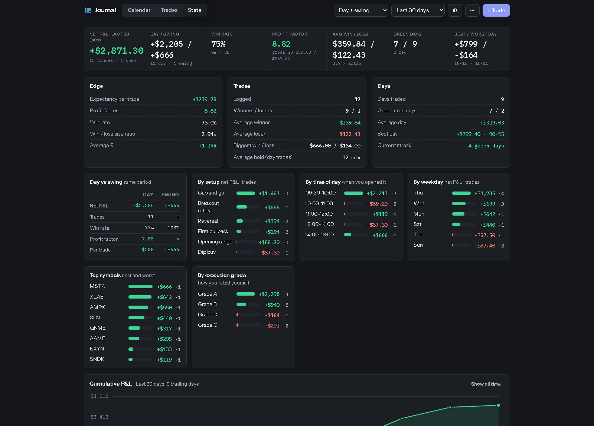
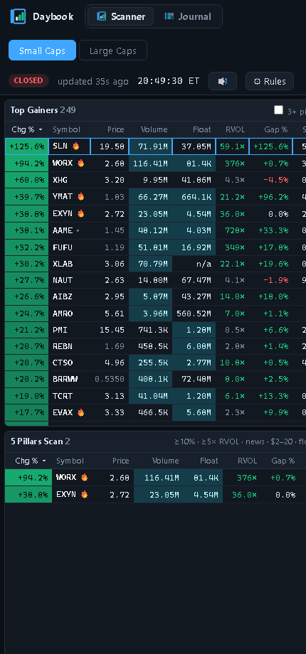

<h1 align="center">
  <br>
  Daybook
</h1>

<p align="center">
  A momentum stock scanner and a trade journal, in one window, running entirely on your own PC.<br>
  <strong>No account. No subscription. Your trades never leave your machine.</strong>
</p>

<p align="center">
  
</p>

---

## Why this exists

Tools like this already exist, and some of them are very good — Trade Ideas, Benzinga Pro,
Warrior Trading's scanners, Tradervue and TraderSync for journalling. They cost somewhere
between $50 and $300 a month, and every trade you log lives on somebody else's server.

Daybook is the small, free version of that idea with one difference that matters: **it runs
on your computer and the data stays there.** Your trade journal is a plain JSON file in this
folder. No account to create, no cloud to sync with, nobody analysing your P&L but you. The
only thing that touches the internet is the market data it fetches from Yahoo Finance.

It is not trying to beat the paid tools. It is trying to be the one you actually own.

## What it does

**Scanner** — finds stocks moving right now, in two tabs: small caps and large caps.

- Live top gainers with price, volume, float, relative volume, gap and short interest
- A **5-pillar scan** that only shows stocks passing every rule you've set
- **Alerts**, with sound, when a stock newly passes all five pillars, makes a new high of
  day, or runs up fast
- News headlines per stock, filtered so "most active stocks" roundups don't count as a catalyst
- TradingView charts: intraday with VWAP and the 9/20 EMAs, plus a daily chart

The default rules follow the five pillars Ross Cameron teaches — up 10% on the day, 5x
relative volume, a news catalyst, priced $2–$20, and a float under 20 million — and every
one of them is editable while the market is running.

**Journal** — a trading journal with a profit-and-loss calendar.

<p align="center">
  
</p>

- Each day on the calendar shows its P&L, and **day trades and swing trades are kept apart**
- A swing trade's result lands on the day you closed it, not the day you opened it
- Positions you haven't closed yet sit above the calendar and count in no day's total
- Entry and exit times, so you can see which part of the session actually pays you
- R multiples when you log your stop, execution grades, setup tags and notes
- One click from the scanner: **+ Journal** starts an entry with the symbol, price and time
  already filled in

<p align="center">
  
</p>

Statistics include expectancy, profit factor, win rate, average R, streaks, and net P&L
broken down by setup, time of day, weekday, symbol and the grade you gave yourself.

## Install (Windows)

1. Install [Python 3.10 or newer](https://www.python.org/downloads/). On the installer's
   first screen, tick **Add python.exe to PATH**.
2. Download this repository — green **Code** button → **Download ZIP** — and unzip it
   somewhere sensible, or clone it:
   ```
   git clone https://github.com/rameezshahid/Daybook.git
   ```
3. Double-click **`install.bat`**. It sets up a private Python environment, installs the one
   dependency, and puts a Daybook shortcut on your desktop.
4. Double-click **Daybook** on your desktop. It opens at <http://localhost:8765>.

That's it. To update later, download the new version and run `install.bat` again — your
journal is a separate file and won't be touched.

<details>
<summary>macOS and Linux</summary>

No installer script yet, but the app itself is cross-platform:

```bash
git clone https://github.com/rameezshahid/Daybook.git
cd Daybook
python3 -m venv .venv && . .venv/bin/activate
pip install -r requirements.txt
python3 server.py
```
</details>

## Using it from your phone or another computer

Daybook runs on one PC, but you don't have to sit at it. [Tailscale](https://tailscale.com)
is free for personal use and puts your devices on a private network — no port forwarding, no
public URL, nothing exposed to the internet.

1. Install Tailscale on the PC and on your phone, signed in to the same account.
2. Run `share_on_tailscale.bat`.
3. Open the address it prints (something like `http://your-pc.tailnet-name.ts.net:8765`) on
   the other device.

On a phone, "Add to Home Screen" gives it an icon and opens it full-screen.

<p align="center">
  
</p>

## Where your data lives

| What | Where |
|---|---|
| Your trades | `journal.json` in this folder, with a backup in `cache/` on every save |
| Cached floats and news | `cache/` |
| Your scanner rules | Your browser's local storage |

Nothing is uploaded anywhere. `journal.json` is in `.gitignore`, so your trades can never be
committed by accident. Export a CSV any time from the journal's **⋯** menu.

## What the free data can and can't do

Daybook reads Yahoo Finance, which is free and good enough to find what's moving. Know its
limits before you lean on it:

- Quotes lag by a few seconds. Use it to find stocks, not to time entries.
- **Pre-market gappers don't appear until 9:30 ET**, because Yahoo's screener ranks on the
  regular session. Use the symbol lookup before the open.
- Float and short interest come from Yahoo's key statistics and are cached for five days.
  They can be stale right after an offering or a reverse split.
- The news check confirms a fresh headline exists. It can't tell you the headline is what's
  moving the stock.
- Relative volume is adjusted for time of day: it compares today's volume against the share
  of a normal day's volume you'd expect by this hour, not against a whole day.

## Built with

Python standard library and [yfinance](https://github.com/ranaroussi/yfinance) on the server,
hand-written HTML, CSS and JavaScript in the browser — no framework, no build step, no
tracking. TradingView's free widget draws the charts.

## Licence and disclaimer

MIT — see [LICENSE](LICENSE). Do what you like with it.

Daybook is a personal tool shared as-is. It is not investment advice, it comes with no
warranty, and it is not affiliated with or endorsed by Warrior Trading, Yahoo, TradingView or
anyone else. Trading is risky and most day traders lose money. Verify anything you see here
against your broker before you act on it.
